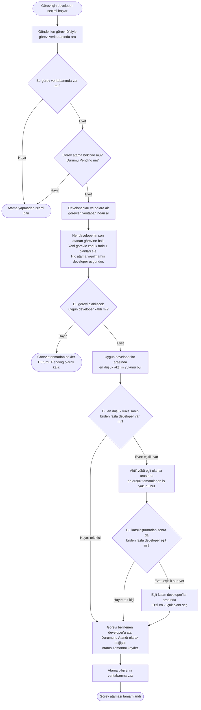

# Görev Atama Akış Şeması

[README'ye dön](../README.md)

Sistem, yeni bir görev için uygun developer'ı (geliştiriciyi) aşağıdaki sırayla belirler. Atama işlemi görev oluşturulduğunda veya kullanıcı **Atamayı Tekrar Dene** butonuna bastığında çalışır. Henüz developer'ı olmayan bir görevin durumu güncellenirken de atama denenir.

Şemayı okumak için üç bilgi yeterli:

- **Atama bekliyor (`Pending`):** Görev için developer seçimi yapılabilir. Zaten atanmış, devam eden veya tamamlanmış görevler bu işlemle yeniden atanmaz.
- **Aktif iş yükü:** Atanmış ve devam eden görevlerin zorluk toplamıdır. Örneğin zorlukları 2 ve 5 olan iki görevin yükü **7**'dir.
- **Tamamlanan iş yükü:** Tamamlanmış görevlerin zorluk toplamıdır. Yalnızca aktif yükler eşitse karşılaştırılır.

## Uygunluk kuralına örnek

Bir developer'a en son **4** zorluğunda görev atanmış olsun:

| Yeni görevin zorluğu | Bu developer'a atanabilir mi? |
| --- | --- |
| 3 veya 5 | Hayır. Son atanan zorlukla farkı 1. |
| 4 | Evet. Aynı zorluğun tekrar atanması serbest. |
| 1, 2, 6, 7 veya 8 | Evet. Zorluk farkı 1 değil. |

**Önemli:** Karşılaştırma, en son **atanan** görevle yapılır; bu görev tamamlanmış olsa da dikkate alınır. En son atama, görevlerin atama zamanından belirlenir.

## Kodla ilişkisi

Seçim `AssignmentService.AssignTask(taskId)` içinde yapılır. Kod, developer'ları bir döngüde tek tek inceler ve o ana kadar bulduğu en uygun kişiyi saklar. Şema aynı seçim önceliklerini gösterir: **uygunluk → aktif yük → tamamlanan yük → ID**. Kesin atama, bütün developer'lar değerlendirildikten sonra yapılır.

Son atama mevcut görev kayıtlarından bulunur; silinen veya Pending'e döndürülerek ataması temizlenen görevlerin geçmişi ayrıca saklanmaz. Görev atanmadan bekliyorsa arka planda otomatik deneme yapılmaz; kullanıcı **Atamayı Tekrar Dene** butonuyla yeniden seçim başlatabilir.
