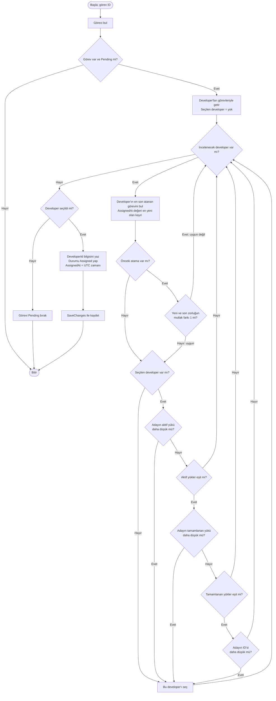

# Görev Atama Akış Şeması

[README'ye dön](../README.md)

Bu şema `AssignmentService.AssignTask(taskId)` metodunu gösterir. Görev oluşturulduktan sonra veya kullanıcı tekrar atama istediğinde çağrılır. GitHub, aşağıdaki Mermaid bloğunu çizim olarak gösterir.

**Hesaplar:** Aktif yük, `Assigned` ve `InProgress`; tamamlanan yük, `Completed` görevlerin zorluk toplamıdır. Karşılaştırmalar yalnızca uygun adaylar arasında yapılır.

**Ardışıklık örneği:** Son atanan zorluk 4 ise 3 ve 5 reddedilir; 4 kabul edilir. Son görev tamamlanmış olsa da değerlendirilir. Önceki ataması olmayan developer uygundur.

**Sınır:** Son atama mevcut görev kayıtlarından bulunur. Silinen veya Pending'e döndürülerek ataması temizlenen görevler bu geçmişte korunmaz. Uygun aday bulunamadığında otomatik bir bekleme döngüsü çalışmaz; kullanıcı daha sonra tekrar atama isteyebilir.
